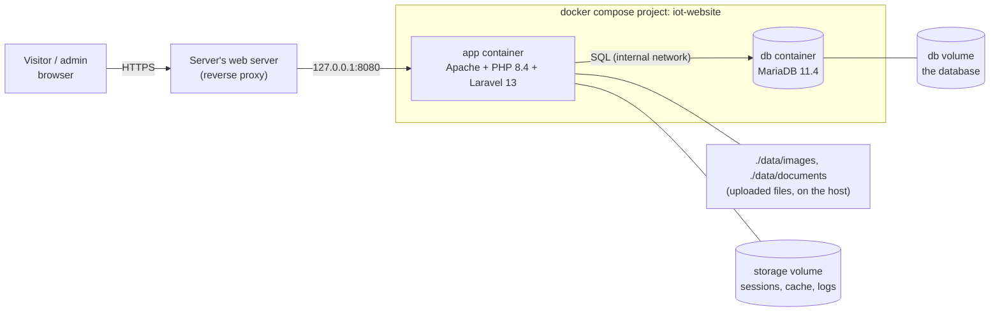
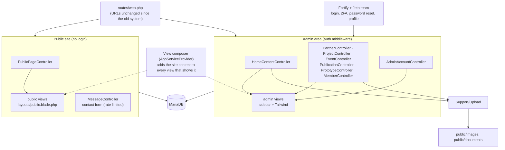

# IoT-ra Lab Website

This is the public website and content-management console for the IoT-ra (Internet of
Things - Research & Applications) Lab at Makerere University (CoCIS, Block B).

- **Visitors** browse the lab's team, projects, prototypes, publications, news and
  partners, and can send the lab a message.
- **Admins** log in to edit all of it without touching code.

**Stack:** Laravel 13 · PHP 8.4 · Blade · Jetstream 5 / Fortify (login, 2FA, password reset)
· MariaDB 11.4 · Apache · Vite. It runs in Docker, isolated from anything else on the server.

- [For editors who used the old system](#for-editors-who-used-the-old-system)
- [Quick start (Docker)](#quick-start-docker)
- [System structure](#system-structure)
- [Everyday commands](#everyday-commands)
- [Checks to run before every merge or deploy](#checks-to-run-before-every-merge-or-deploy)
- [Deploying on the server](#deploying-on-the-server)
- [Documentation](#documentation) · [Security](#security)

---

## For editors who used the old system

You can carry on as before. The admin area works the way it always has: the same sidebar
(Dashboard, Home, Projects, Products, News, Current Team, Past Team), the same forms, and
the same order of steps.

**What changed for you:**

| | Before | Now |
|---|---|---|
| **Your account** | Email and password | **The same email and password.** Passwords are now stored securely; this happens automatically when the new version starts. |
| **Where to log in** | `/oldlogin` | The **Admin login** button at the top of the site, or `/login`. Old `/oldlogin` bookmarks still work. |
| **First visit after the update** | — | You'll be asked to log in once more. |
| **The dashboard** | Grey "+" boxes that did nothing | The boxes are shortcuts: "Add a project", "Contacts", and so on. |
| **Two-step login (2FA)** | Could be skipped | Optional. Turn it on under **Profile & security** in the sidebar, and you'll be asked for the code from your phone at every login. |
| **Forgot your password** | No working reset | **Forgot password?** on the login page emails a reset link (once the server's email is set up). A maintainer can also reset it: see [Everyday commands](#everyday-commands). |
| **Contacts and social links** | Always shown | Each one has a **Show on the website** switch, so you can hide one without deleting it. |
| **Missing content** | Blank gaps on the public site | Visitors see nothing missing. While logged in, you see a "hasn't been added yet" note with a link to the right form. |

A step-by-step guide to every task is in [docs/workflows.md](docs/workflows.md).

---

## Quick start (Docker)

You need Docker with the Compose plugin. PHP, Node and MySQL don't need to be installed.

```bash
git clone git@github.com:ademnea/iot_website.git
cd iot_website
cp .env.example .env
```

In `.env`, set `DB_PASSWORD` and `DB_ROOT_PASSWORD` (any strong values), then:

```bash
docker compose run --rm --no-deps app php artisan key:generate --show   # put the output in .env as APP_KEY=
docker compose up -d --build                                            # site on http://127.0.0.1:8080
docker compose exec app php artisan admin:create you@example.org --name="Your Name"
```

1. **Open the site.** Go to http://127.0.0.1:8080. The home page shows straight away under
   the lab's name, even before any content is added.
2. **Log in.** Click **Admin login** in the header.
3. **Add the content.** Start with the lab's details, then the logo, banner and contacts:
   Dashboard → **Lab information**, or Home → **Add New Home Content**.

---

## System structure

### How the pieces fit



- **`app`:** Apache with mod_php serving `public/`. The site listens only on localhost, so
  the server's main web server must proxy the domain to it.
- **`db`:** a private MariaDB that only `app` can reach.
- **Uploads:** photos, logos and documents live in `./data` on the host, so they survive
  rebuilds and are easy to back up.
- **`test`:** started only by the check suite. It runs the tests against a separate
  database (`iot_website_test`).

**What happens on each start** (`docker/entrypoint.sh`):
1. Wait for the database.
2. Run any new migrations.
3. Hash any admin passwords still stored as plain text (`admin:hash-passwords`).
4. Cache the config and views.
5. Start Apache.

The container reports healthy only when Apache, PHP and the database all answer.

### Inside the application

Every page is rendered on the server with Blade. The site has no separate API or JavaScript
front-end app.



There is one controller per kind of content. Each one holds everything for that content
type: its admin list (`index`), add (`store`), edit page (`edit`) and save (`update`).

| Controller | Sidebar | Handles |
|---|---|---|
| `PublicPageController` | — | Every public page (`fetch_home`, `fetch_projects`, …) |
| `HomeContentController` | Home | Lab details, logo, banner, contacts, social links, the leader's message |
| `PartnerController` | Home | Partners: add, edit |
| `ProjectController` | Projects | List, add, edit |
| `PublicationController` | Products | List (with the prototypes), add, edit |
| `PrototypeController` | Products | Add (there is no edit page) |
| `EventController` | News | List, add, edit; extra photos are added, not replaced |
| `MemberController` | Current Team, Past Team | List, add, edit, deactivate (to Past Team), restore |
| `AdminAccountController` | Dashboard | "Add another admin" |
| `MessageController` | — | The public contact form |

**Shared code:**

| Code | Does |
|---|---|
| `App\Support\Upload` | Holds the upload rules (`Upload::IMAGE`, `Upload::DOCUMENT`) and stores every file under a generated name (`Upload::store`) |
| `Controller::findForEdit()` | Loads the record an edit page opens, or shows Not Found |
| `Controller::dateInput()` | Formats a date for a date field |
| The view composer in `AppServiceProvider` | Passes `$contents` (the lab's details) to every view that shows them, so controllers don't load it |

**Background:**
- [ADR-0009](docs/adr/0009-controllers-by-content-type.md) records why the controllers are
  organised this way.
- The previous controllers, grouped by operation (`insert_data`, `edit_data`, …), are kept
  in `legacy/controllers/`, with a table showing where each method moved.

### Public pages

| URL | Controller method | View | Shows (tables) |
|---|---|---|---|
| `/` | `PublicPageController@fetch_home` | `index` | Lab identity, vision/mission/objectives, leader's message, partners (`website_content`, `members`, `partners`) |
| `/projects` | `fetch_projects` | `projects` | Ongoing projects with photos (`projects`, `project_photos`) |
| `/publications` ("Research") | `fetch_publications` | `publications` | Publications and prototypes (`publications`, `prototypes`, `prototype_photos`) |
| `/news` | `fetch_events` | `news` | Current and past events (`events`, `event_photos`) |
| `/about` ("Team & contact") | `fetch_team` | `about_us` | Leader, researchers, students, interns, partners, and the contact form (`members`, `partners`) |
| `/partners` | `fetch_partners` | `partners` | All partners |
| `/gallery`, `/team_gallery`, `/project_gallery`, `/prototypes_gallery`, `/events_gallery` | `fetch_*gallery` | same names | Photo galleries |
| `POST /insert_message` | `MessageController@store` | — | Saves a visitor's message (`messages`); limited to 5 per minute per visitor |

Every public page uses the shared `layouts/public.blade.php`. It provides the top bar,
header, navigation and footer, and reads the single `website_content` row for the lab's
name, logo, contacts and social links.

### Admin area (login required)

| Sidebar | Lists at | Add form | Edit pages |
|---|---|---|---|
| Dashboard | `/dashboard` (shortcuts) | — | — |
| Home | `/homecontent` | `/register_home` (lab info, contacts, partners) | `/edithome` `/editlogo` `/editbanner` `/editcontacts` `/edittopbar` (social links) `/editleader` `/editpartner` |
| Projects | `/projectscontent` | `/register_projects` | `/editproject` |
| Products | `/publicationscontent` | `/register_publications`, `/registerprototype` | `/editpublications` |
| News | `/newscontent` | `/register_news` | `/editnews` |
| Current Team | `/aboutuscontent` | `/register_team` | `/editteam`; Deactivate (`POST /deleteuser`) |
| Past Team | `/oldteam` | — | Restore (`POST /restoreuser`) |
| Profile & security | `/user/profile` | — | Name, email, password, 2FA, browser sessions |
| (Dashboard) Add another admin | `/register` | `POST /registeradmin` | — |

**Accounts:**
- Every admin can change everything; there are no roles.
- Only a logged-in admin, or a maintainer on the server, can create another admin.
- All logins go through Fortify at `/login`, which applies 2FA and the 5-attempts-per-minute
  limit.

### Data

All content is stored in MariaDB. The main tables are:

| Table | Holds |
|---|---|
| `website_content` | One row: lab name, motto, vision, mission, objectives, logo, banner, contacts, social links, the leader's message, and a show/hide switch for each contact and link |
| `members` | Team members: name, role (leader, researcher, PhD/Masters student, intern, admin), bio, photo, status (Active/Inactive) |
| `projects` + `project_photos` | Projects and their photos |
| `events` + `event_photos` | News and events and their photos |
| `publications` | Publications, with an optional cover and document |
| `prototypes` + `prototype_photos` | Prototypes, linked to a project |
| `partners` | Partner organisations and their logos |
| `messages` | Contact-form messages from visitors |
| `users` | Admin accounts (hashed passwords, optional 2FA) |
| `sessions`, `password_reset_tokens`, … | Laravel housekeeping |

**Tables that are defined but not used yet:** `scholarships`, `careers`, `applicants`,
`newsletters` and the link tables. The full diagram is in
[docs/system-design.md](docs/system-design.md).

**Uploads:**
- **Where they go:** under `public/images/<kind>/` (logo, banner, team, partners, events,
  projects, publications, prototypes) and `public/documents/publications/`. In Docker,
  both folders are `./data` on the host.
- **Names:** files are saved under generated names, so two uploads called `photo.jpg`
  never overwrite each other.
- **Safety:** an `.htaccess` file in each folder stops any uploaded script from running.

### Front end

- **Public pages:** one stylesheet, `resources/css/public.css`, built by Vite into
  `public/build/`. The fonts (Sora, Heebo, IBM Plex Mono) come from Google Fonts.
  Everything else is served by the site itself, including the network-mesh tower drawing
  (`resources/views/public/mesh.blade.php`), so the public pages load no outside
  JavaScript or CSS libraries.
- **Admin pages:** Tailwind with the lab's blue palette (`partials/admin-theme.blade.php`,
  matching `tailwind.config.js`).
- **Brand colours:** mesh navy `#034486`, signal blue `#0C9CF2`, and honey orange `#FE8800`
  as a sparing accent. Logo and favicon files are in `public/img/`. The design sources are
  in [docs/design/](docs/design/).

### Repository layout

```text
app/
  Http/Controllers/     One controller per content type (PublicPage, HomeContent, Partner, Project, Event, Publication,
                        Prototype, Member, AdminAccount, Message); shared helpers in Controller.php
  Models/               Eloquent models (website_content, members, projects, publications, prototypes, partners, User, …)
  Support/              Upload (rules + generated names), Url (cleans links typed by admins), SiteContent (which contacts/socials are shown)
  Actions/Fortify/      Password rules, profile and password updates
  Providers/            View composer for the site content, Fortify setup (login page, rate limits), named rate limiters
database/migrations/    The schema, from 2023 plus the show/hide switches (2026-10-21)
resources/
  views/                Admin pages (homecontent, register_*, edit*, dashboard, sidebar) and public pages (index, projects, news, …)
    layouts/public.blade.php   Shared public layout
    public/             Mesh drawing, social icons
    components/         <x-admin-hint> and the Jetstream components
    legacy/             The previous public templates, kept for reference
  css/public.css        Public stylesheet (Vite)
routes/
  web.php               All routes; the admin area is inside the auth group
  console.php           admin:create, admin:password, admin:reset-2fa, admin:hash-passwords
public/                 Web root: index.php, built assets, img/ (logo, icons), images/ + documents/ (uploads)
docker/                 entrypoint.sh, Apache and PHP settings, database init script
Dockerfile              Images: vendor → assets → app (production) → test
docker-compose.yml      app + db (+ test profile)
scripts/check.sh        Guard, tests and DevSecOps scans
tests/Feature/          Feature tests; Fixes/ has one regression test file per fixed defect, Refactor/ pins down
                        every admin form and page's data
legacy/controllers/     The pre-2026-10-21 controllers, kept for reference (not loaded)
docs/                   SRS, architecture, design, ADRs, workflows, reports, fix log
```

---

## Everyday commands

| Task | Command |
|---|---|
| Stop / start | `docker compose stop` / `docker compose start` |
| Take the site down (data is kept) | `docker compose down` |
| Logs | `docker compose logs -f app` |
| Artisan | `docker compose exec app php artisan <command>` |
| Database shell | `docker compose exec db sh -c 'mariadb -u"$MARIADB_USER" -p"$MARIADB_PASSWORD" "$MARIADB_DATABASE"'` |
| Rebuild after pulling | `docker compose up -d --build` |
| Create an admin | `docker compose exec app php artisan admin:create you@example.org --name="Your Name"` |
| Reset an admin's password | `docker compose exec app php artisan admin:password you@example.org` |
| Turn off an admin's 2FA (lost phone) | `docker compose exec app php artisan admin:reset-2fa you@example.org` |

Never use `docker compose down -v`: the `-v` deletes the database.

---

## Checks to run before every merge or deploy

```bash
scripts/check.sh
```

This one command runs everything in Docker: the repository guard, the test suite and the
DevSecOps scans.

- **Speed:** after the guard and the image build, the jobs run **in parallel**, so the
  scans add almost no time. A typical run takes about 30 seconds; the first run takes
  longer because it builds the images.
- **Specific jobs:** name them (`scripts/check.sh tests smoke`), or use
  `scripts/check.sh security` for the scanners only.
- **Output:** logs, the Semgrep report and the SBOM are saved in `reports/<timestamp>/`.

| Job | What it checks |
|---|---|
| `guard` | No archives/executables committed (the [Dec 2025 malware](docs/incident-report-2025-12-malware.md) pattern), no webshell code, no `.env` files |
| `tests` | The PHPUnit suite against a throwaway database (`iot_website_test`) |
| `audit` | Known vulnerabilities in PHP packages (fails) and npm build tools (reported) |
| `sast` | Semgrep static analysis of the code |
| `secrets` | Gitleaks: secrets in git history and the working tree |
| `image` | Trivy: fixable vulnerabilities or secrets in the Docker image; writes an SBOM |
| `config` | Trivy: Dockerfile/compose misconfigurations |
| `lint` | Hadolint: Dockerfile issues |
| `compile` | Every Blade template, route and config file loads |
| `smoke` | The running site answers correctly, sends security headers, and refuses to run scripts from uploads |

What each job means, and what to do when one fails, is in
[docs/fixes/011](docs/fixes/011-maintainer-checks.md).

---

## Deploying on the server

1. **Configure.** Clone the repo on the server and create `.env` as in the quick start, with
   `APP_ENV=production`, `APP_DEBUG=false` and `APP_URL=https://<your domain>`. Fill in the
   `MAIL_*` settings with the lab's email account, so "Forgot password?" can send reset
   emails.
2. **Bring the content over.**
   - Copy the existing uploads into `./data/images` and `./data/documents`.
   - Load a `mysqldump` of the old database with `docker compose exec -T db mariadb …` (see
     [fix 009](docs/fixes/009-containerisation.md)).
   - Admins' plain-text passwords are hashed on the first start, so editors keep their
     passwords.
3. **Start.** Run `docker compose up -d --build`. The site listens on `127.0.0.1:8080`
   only.
4. **Proxy.** Have the host's web server proxy the domain to the site (Apache example in
   [fix 009](docs/fixes/009-containerisation.md)). `TRUSTED_PROXIES=*` in `.env` is safe
   while the port is bound to localhost.
5. **Check.** Run `scripts/check.sh smoke` against the live stack.

**Back up** `./data/` and the database:
`docker compose exec db sh -c 'mariadb-dump -u"$MARIADB_USER" -p"$MARIADB_PASSWORD" "$MARIADB_DATABASE"' > backup.sql`.

---

## Documentation

| Document | For |
|---|---|
| [Workflows](docs/workflows.md) | Editors: how to do each task in the admin area, step by step |
| [docs/README.md](docs/README.md) | The index: SRS, architecture, system design, SDD and ADRs |
| [Defects and malware report](docs/defects-and-malware-report.md) · [fix log](docs/fixes/README.md) | What was wrong, and how each item was fixed and tested |
| [Incident report: Dec 2025 malware](docs/incident-report-2025-12-malware.md) | What happened, and a runbook of the clean-up commands |

---

## Security

Report vulnerabilities privately to the lab maintainers, not in a public issue.

- Never commit archives or executables (`.zip`, `.exe`, `.dll`, `.cmd`). `scripts/check.sh`
  fails if you do.
- Admin accounts are created only by another admin or with `php artisan admin:create`.
- Two-factor authentication is available on each admin's profile page and is enforced at
  login once turned on.
