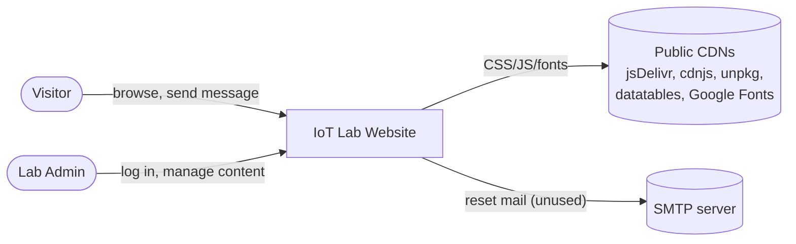
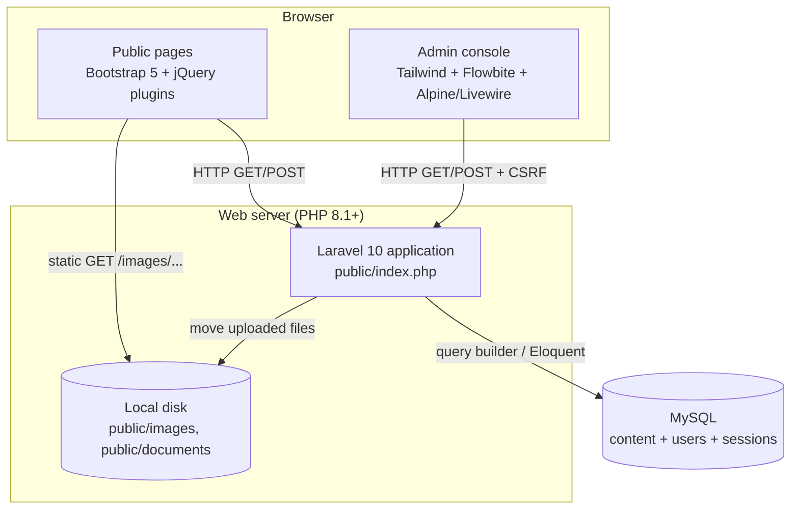
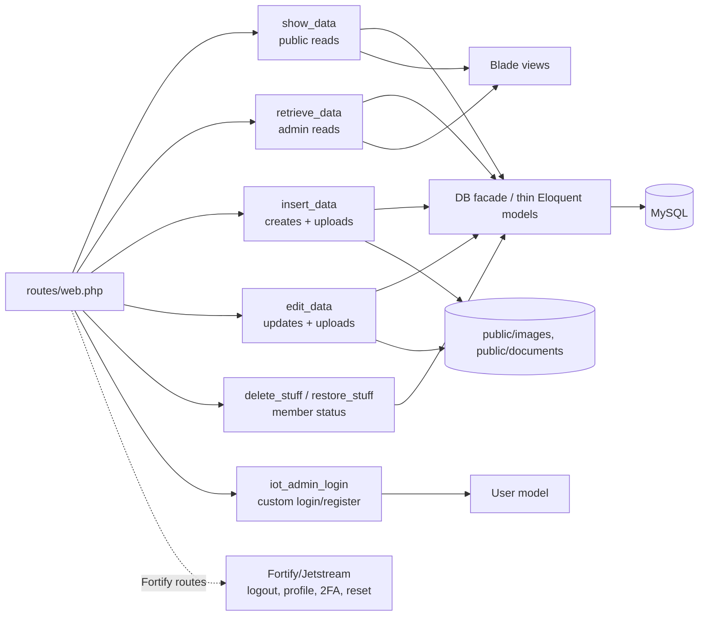
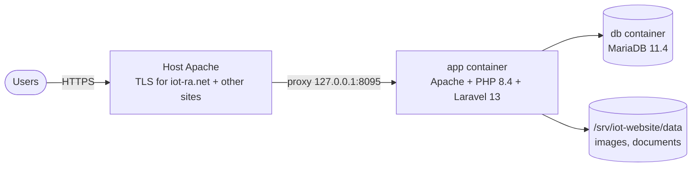
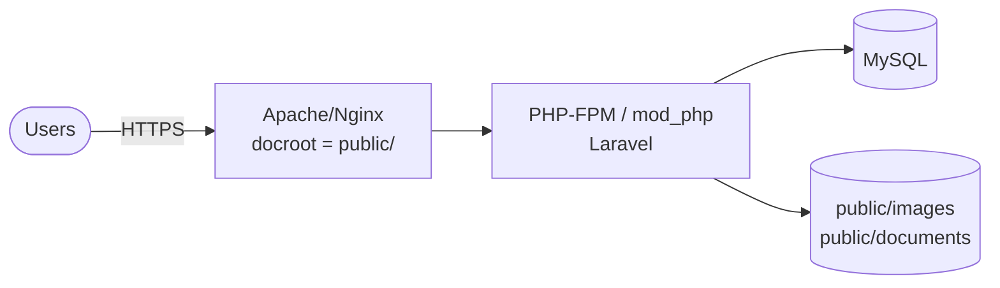

# Architecture

**System:** IoT-ra Lab website. **Baseline:** commit `af3c109`, 2026-10-20.

> **Update 2026-10-21:** this document describes the baseline. The site now runs in Docker
> (Laravel 13, PHP 8.4, MariaDB 11.4), behind the server's Apache, with one login path
> through Fortify and controllers grouped by content type. Section 4 shows the current
> deployment. For details, see [deployment.md](deployment.md),
> [ADR-0009](adr/0009-controllers-by-content-type.md) and the [fix log](fixes/README.md).

This document uses a C4-style view: context → containers → components →
deployment, followed by cross-cutting concerns and a risk register.

---

## 1. System context

The system has no inbound integrations and no outbound API calls. The only
external runtime dependency is the browser fetching front-end assets from CDNs.

---

## 2. Containers

| Container | Technology | Responsibility |
|---|---|---|
| Laravel app | Laravel 10, Jetstream 3, Fortify, Sanctum, Livewire 2 | Routing, auth, controllers, Blade rendering |
| MySQL | MySQL/MariaDB | All content, users, DB-backed sessions |
| Local file store | `public/` directory | Uploaded images and publication documents, served directly by the web server |
| Browser UI | Blade output + CDN libs | Public theme (Bootstrap) and admin theme (Tailwind/Flowbite) |

---

## 3. Components (inside the Laravel app)

Key traits of the component layer:

- **Controllers grouped by verb, not by resource.** `insert_data` creates every
  entity type and `edit_data` updates every entity type. Adding a new entity
  touches four or more controllers.
- **No service, repository or form-request layer.** Validation, file handling
  and persistence all live inline in controller methods.
- **Thin models.** Models only set `$table` and have no relationships or
  `$fillable`. Joins are written by hand with `DB::table()`.
- **Two auth stacks side by side.** See §5.2 and ADR-0003.

---

## 4. Deployment view

### 4.1 Current (since 21 Oct 2026)

- **Code and settings:** in `/srv/iot-website` on the lab's server.
- **Runtime:** the site runs in its own containers, with its own PHP and database, so the
  other sites on the server are isolated from it.
- **Builds:** the Docker image is built on the server with `docker compose up -d --build`.
- **On start:** migrations and password hashing run automatically.
- **Checks:** `scripts/check.sh` runs the tests and the security scans before a merge.

See [deployment.md](deployment.md) for everything else.

### 4.2 Baseline (until 21 Oct 2026)

**How it was built and deployed**, from `installation.txt`:
1. `composer install` (the notes say `composer update`; prefer `install` with the lock file)
2. `npm install && npm run build` (Vite builds `resources/css/app.css` and `resources/js/app.js`)
3. Create `.env`, `php artisan key:generate`, `php artisan migrate`
4. Create the first admin (currently by inserting into `users` directly)
5. Point the web server's docroot at `public/`

**What was missing:**
- **CI/CD, containers, backups, separate environments:** none of these were in the repo.
- **Upload backups:** uploaded media lives under `public/` and is git-ignored, so it had to
  be backed up separately from the database.
- **On the server:** the old site ran from `/var/www/iot-ra.net/public_html/iot_website`
  on the host's PHP-FPM 8.2, sharing the server's MySQL.

---

## 5. Cross-cutting concerns

### 5.1 Configuration
`.env` (from `.env.example`). Important keys: `APP_KEY`, `APP_DEBUG` (must be
`false` in production), `DB_*`, `SESSION_DRIVER=database`.

### 5.2 Authentication and authorisation
- **Custom path (actually used):** `/oldlogin` (named `login`) renders the
  form, which posts to `/mylogin`. That calls `iot_admin_login@login`, which
  compares the plaintext password and then calls `Auth::login()`.
- **Fortify/Jetstream path:** registered automatically. It provides `logout`,
  the profile pages, 2FA and password reset. All of these hash passwords, so
  any password Fortify sets can no longer be used at the custom login, and the
  reverse is also true.
- **Authorisation:** the `auth` middleware only. There are no roles, policies
  or gates.

### 5.3 Session and CSRF
Database-backed sessions. CSRF protection uses Laravel's `VerifyCsrfToken`;
forms include `@csrf`.

### 5.4 Error handling and logging
Laravel defaults (`stack` channel, `storage/logs`). Nothing is logged at the
application level.

### 5.5 Front-end assets
- Vite bundles only the Jetstream/Tailwind assets.
- The public theme loads `public/css`, `public/js/main.js` and the jQuery
  plugins in `public/lib/*`, which are duplicated under `resources/lib`.
- Bootstrap, Font Awesome, Tailwind 2 (unpkg), Flowbite and DataTables come
  from CDNs without SRI hashes.

---

## 6. Quality attributes and risk register

| # | Risk | Severity | Evidence | Mitigation |
|---|---|---|---|---|
| R1 | Malware committed to the repo, and the README points visitors to it | **Critical** | `public/lib/owlcarousel/assets/iot_website-v1.5.zip`, commits `4e4dcbe`, `af3c109` | ADR-0008 |
| R2 | Anyone can register an admin account | **Critical** | `routes/web.php:42-44` | ADR-0006 |
| R3 | Plaintext passwords | **Critical** | `insert_data.php:41`, `iot_admin_login.php:22` | ADR-0006 |
| R4 | Credentials accepted over GET | High | `routes/web.php:38` | ADR-0006 |
| R5 | Upload filename collisions and overwrites, original names trusted | High | every `getClientOriginalName()` | ADR-0007 |
| R6 | Stored XSS through unescaped `{!! !!}` output | Medium | 10 views | Sanitise on write (HTML Purifier) or escape |
| R7 | Spoofable `admin_id` / `registered_by` from hidden fields | Medium | `register_team.blade.php:35` | Use `auth()->id()` |
| R8 | Unthrottled public contact form | Medium | `routes/web.php:122` | `throttle` middleware + validation |
| R9 | No tests for custom features | Medium | `tests/Feature` is scaffold only | Feature tests per controller |
| R10 | CDN assets without SRI, mixed versions (Bootstrap 5.0 and 5.3) | Low | views | Bundle via Vite or add SRI |
| R11 | Non-atomic multi-table writes | Low | `insert_news`, `insert_project`, `insert_prototype` | `DB::transaction` |
