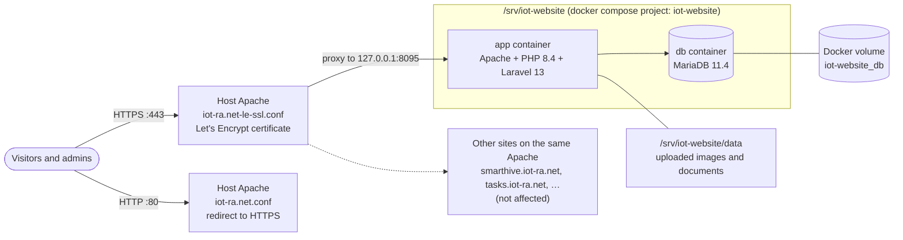

# Deployment

How the IoT-ra Lab website runs in production, how it was deployed on **21 October 2026**,
and how to update, back up, roll back and troubleshoot it.

- **Live site:** https://iot-ra.net (also `www.iot-ra.net`)
- **Server:** the lab's Ubuntu 22.04 server. Maintainers log in with their own account,
  which must be in the `docker` group.
- **Run by:** Docker Compose. The server's own Apache sits in front and handles HTTPS.

---

## 1. How it fits together



| Part | Where | Notes |
|---|---|---|
| Code and settings | `/srv/iot-website` (a clone of `ademnea/iot_website`, branch `main`) | `.env` is readable only by its owner (`chmod 600`) |
| The site | Container `iot-website-app-1` | Published on **`127.0.0.1:8095`** only. Port 8080 is taken by the host's Apache, so 8095 is used instead. |
| The database | Container `iot-website-db-1` (MariaDB 11.4) | Not published to the host. Its data is in the Docker volume `iot-website_db`. Separate from the server's own MySQL. |
| Uploads | `/srv/iot-website/data/images`, `/srv/iot-website/data/documents` | Plain folders on the host, easy to back up |
| Sessions, cache, logs | Docker volume `iot-website_storage` | |
| HTTPS | Host Apache, `/etc/apache2/sites-available/iot-ra.net-le-ssl.conf` | Let's Encrypt certificate in `/etc/letsencrypt/live/iot-ra.net/`, renewed by certbot as before |

**Why it's laid out like this:**
- **Separate from the other sites.** The lab site has its own PHP, its own database and
  its own folder, so a change for one site can't break another. The old site shared the
  server's PHP-FPM 8.2 with them.
- **Not in a web-served folder.** `/srv/iot-website` isn't under `/var/www`. Even with a
  mistake in Apache's config, `.env` and `.git` can't be downloaded.
- **No Nginx.** It's installed on the server but isn't serving anything, and this
  deployment doesn't use it.

---

## 2. Production settings (`/srv/iot-website/.env`)

These differ from `.env.example`. Never commit `.env` or paste it anywhere.

| Setting | Value | Why |
|---|---|---|
| `APP_ENV` | `production` | |
| `APP_DEBUG` | `false` | Error pages must not show code or settings (defect F8) |
| `APP_URL` | `https://iot-ra.net` | Used for links in emails |
| `APP_KEY` | Generated once (see 3.4) | Encrypts sessions. Changing it logs everyone out. |
| `APP_PORT` | `8095` | The port the host's Apache forwards to |
| `LOG_LEVEL` | `warning` | |
| `DB_PASSWORD`, `DB_ROOT_PASSWORD` | Random 48-character values | For the containers' own MariaDB; nobody needs to type them |
| `SESSION_SECURE_COOKIE` | `true` | The login cookie is only sent over HTTPS |
| `TRUSTED_PROXIES` | `*` (default) | Safe because the site is only reachable from the server itself (`APP_BIND=127.0.0.1`) |
| `MAIL_*` | **To fill in** | Needed for "Forgot password?" emails (see 6.5) |

---

## 3. First deployment (what was done on 21 Oct 2026)

Kept here so it can be repeated on a new server.

### 3.1 Checks
```bash
docker compose version                      # Compose v2 or later (the server has v5.5.1)
groups | tr ' ' '\n' | grep -x docker       # can run docker without sudo
ss -ltn | grep -E ':8095\b' || echo "8095 is free"
sudo ss -ltnp | grep -E ':(80|443)\b'       # which web server faces the public (here: apache2)
sudo grep -rl "iot-ra" /etc/apache2/sites-available   # the site's Apache config files
```
The site's configs are in `sites-available`. The files in `sites-enabled` are only links to
them, which `grep -r` doesn't follow.

### 3.2 Back up what was there
```bash
cd /var/www/iot-ra.net/public_html/iot_website          # the old site
set -a; . ./.env; set +a; export MYSQL_PWD="$DB_PASSWORD"
mysqldump --no-tablespaces -h"$DB_HOST" -u"$DB_USERNAME" --single-transaction "$DB_DATABASE" > ~/iotra_iotra_before_deploy_$(date +%F).sql
unset MYSQL_PWD; chmod 600 ~/iotra_iotra_before_deploy_*.sql
```

### 3.3 Get the code
```bash
sudo mkdir -p /srv/iot-website
sudo chown "$USER:$(id -gn)" /srv/iot-website
git clone https://github.com/ademnea/iot_website.git /srv/iot-website
cd /srv/iot-website
```

### 3.4 Settings, key and start
```bash
cp .env.example .env && chmod 600 .env
sed -i \
  -e 's|^APP_ENV=.*|APP_ENV=production|' \
  -e 's|^APP_DEBUG=.*|APP_DEBUG=false|' \
  -e 's|^APP_URL=.*|APP_URL=https://iot-ra.net|' \
  -e 's|^LOG_LEVEL=.*|LOG_LEVEL=warning|' \
  -e 's|^APP_PORT=.*|APP_PORT=8095|' \
  -e "s|^DB_PASSWORD=.*|DB_PASSWORD=$(openssl rand -hex 24)|" \
  -e "s|^DB_ROOT_PASSWORD=.*|DB_ROOT_PASSWORD=$(openssl rand -hex 24)|" \
  .env
echo "SESSION_SECURE_COOKIE=true" >> .env

# -T: no terminal is attached inside $( … ); without it the key may not be captured
KEY=$(docker compose run --rm -T --no-deps app php artisan key:generate --show | tail -1)
sed -i "s|^APP_KEY=.*|APP_KEY=$KEY|" .env; unset KEY
grep -c '^APP_KEY=base64:' .env             # must print 1

docker compose up -d --build --wait         # first build: about 2–10 minutes
docker compose ps                           # app and db: healthy
curl -s -o /dev/null -w "%{http_code}\n" http://127.0.0.1:8095/     # 200
```

On every start, the container:
1. waits for the database;
2. runs any new migrations;
3. hashes any plain-text admin passwords;
4. caches the config and views.

### 3.5 First admin account
```bash
docker compose exec app php artisan admin:create <email> --name="<Name>"
```
- The command asks for the password twice and doesn't show it.
- Further admins can be added in the browser: Dashboard → **Add another admin**.
- Give everyone their own account. Each should turn on two-factor login under
  **Profile & security**.

### 3.6 Switch the domain to the new site
Back up the HTTPS config, then replace it:
```bash
sudo cp /etc/apache2/sites-available/iot-ra.net-le-ssl.conf ~/iot-ra.net-le-ssl.conf.before-deploy
sudo a2enmod proxy proxy_http headers
```

`/etc/apache2/sites-available/iot-ra.net-le-ssl.conf` now reads:
```apache
<IfModule mod_ssl.c>
<VirtualHost *:443>
    ServerName iot-ra.net
    ServerAlias www.iot-ra.net

    # The lab website runs in Docker (/srv/iot-website, see its README).
    # Apache handles HTTPS and forwards every request to the container.
    ProxyPreserveHost On
    ProxyPass        / http://127.0.0.1:8095/
    ProxyPassReverse / http://127.0.0.1:8095/
    RequestHeader set X-Forwarded-Proto "https"
    RequestHeader set X-Forwarded-Port "443"
    ProxyTimeout 120

    ErrorLog ${APACHE_LOG_DIR}/iot-ra.net-error.log
    CustomLog ${APACHE_LOG_DIR}/iot-ra.net-access.log combined

Include /etc/letsencrypt/options-ssl-apache.conf
SSLCertificateFile /etc/letsencrypt/live/iot-ra.net/fullchain.pem
SSLCertificateKeyFile /etc/letsencrypt/live/iot-ra.net/privkey.pem
</VirtualHost>
</IfModule>
```

Test, then reload:
```bash
sudo apache2ctl configtest            # must say "Syntax OK"
sudo systemctl reload apache2         # graceful; the other sites keep running
```
`iot-ra.net.conf` (port 80) only redirects to HTTPS; section 7 removes its old
`DocumentRoot`.

### 3.7 Check it
Run the checks in section 5.1.

**Result on 21 Oct 2026:**
- The home page and `/login` returned 200 under the lab's name.
- The security headers were present.
- All assets loaded over HTTPS.
- `smarthive.iot-ra.net` was unaffected.

---

## 4. Content after the deployment

The old site's database (`iotra_iotra` on the server's MySQL) was found **empty** on
21 Oct 2026. Every table had been recreated on 16 Oct 2026 at 08:27, during the move from
cPanel, and no dump on the server contained the old content. It held one admin account
only.

| Item | Status |
|---|---|
| Database content | **Lost before this deployment.** Re-entered by the editor through the admin area ([workflows.md](workflows.md)). |
| Uploaded files from the old site | 100 files (36 team, 30 events, 12 publication covers, 10 projects, 8 documents, 2 logos, 2 banners). All were checked to be real images or documents, then given to the editor as a zip for re-uploading. |
| Admin accounts | Created fresh with `admin:create`. Old accounts don't carry over. |

---

## 5. Day-to-day operations

All commands run from `/srv/iot-website`.

### 5.1 Is it healthy?
```bash
docker compose ps                                                         # both "healthy"
curl -s -o /dev/null -w "%{http_code}\n" https://iot-ra.net/              # 200
curl -s https://iot-ra.net/ | grep -o "<title>[^<]*"                      # the lab's name
curl -s -o /dev/null -w "%{http_code}\n" https://iot-ra.net/login         # 200
curl -s -o /dev/null -w "%{http_code}\n" https://iot-ra.net/dashboard     # 302 (login required)
curl -sI https://iot-ra.net/ | grep -iE "x-content-type-options|x-frame-options"
curl -s -o /dev/null -w "%{http_code} %{redirect_url}\n" http://iot-ra.net/   # 301 https://iot-ra.net/
```

Don't run `scripts/check.sh` on the production server. It rebuilds and restarts the
stack. Run it on a development machine before merging (see the README).

### 5.2 Update to a new version
After a pull request is merged into `main`:
```bash
cd /srv/iot-website
git pull
docker compose up -d --build --wait
docker compose ps
```
Then run the checks in 5.1.

**Downtime:** the site is unavailable for a few seconds while the app container restarts.
Migrations run automatically.

### 5.3 Accounts
| Task | Command |
|---|---|
| Create an admin | `docker compose exec app php artisan admin:create <email> --name="<Name>"` |
| Reset a forgotten password | `docker compose exec app php artisan admin:password <email>` |
| Turn off 2FA (lost phone) | `docker compose exec app php artisan admin:reset-2fa <email>` |

### 5.4 Logs
```bash
docker compose logs --tail=100 app          # the site
docker compose logs --tail=100 db           # the database
sudo tail -n 100 /var/log/apache2/iot-ra.net-error.log     # the front Apache
```

### 5.5 Backups
```bash
mkdir -p ~/backups/iot-website
# database
docker compose exec -T db sh -c 'mariadb-dump -u"$MARIADB_USER" -p"$MARIADB_PASSWORD" "$MARIADB_DATABASE"' \
  > ~/backups/iot-website/db_$(date +%F).sql
# uploads
tar czf ~/backups/iot-website/data_$(date +%F).tar.gz -C /srv/iot-website data
chmod 600 ~/backups/iot-website/*
```
- **Keep a copy off the server.** The 16 Oct 2026 content loss happened because the only
  copy was on the server being rebuilt.
- **Schedule it:** a weekly cron job running these lines is the recommended next step.

**Restore the database:**
```bash
docker compose exec -T db sh -c 'mariadb -u"$MARIADB_USER" -p"$MARIADB_PASSWORD" "$MARIADB_DATABASE"' < ~/backups/iot-website/db_<date>.sql
```

**Never** run `docker compose down -v`: `-v` deletes the database volume.

### 5.6 Stop or start
```bash
docker compose stop        # site down; visitors get a 503 from Apache
docker compose start
docker compose down        # removes the containers; data and database are kept
docker compose up -d --wait
```

---

## 6. Troubleshooting

### 6.1 "pull access denied for iot-website"
Harmless. The image is built on the server, not downloaded, so Docker's download attempt
fails before it builds.

### 6.2 "failed to get console: provided file is not a console"
This appears when `docker compose run` is used inside `$( … )`. Add `-T`, as in 3.4. If it
happened while generating the key, check with `grep -c '^APP_KEY=base64:' .env`.

### 6.3 The app container keeps restarting
```bash
docker compose logs --tail=40 app
```
- **"APP_KEY is not set":** generate the key (3.4), then run `docker compose up -d --wait`.
- **"Database not reachable after 120s":** check `docker compose ps db` and
  `docker compose logs db`.

### 6.4 The site gives 503 Service Unavailable
Apache can't reach the container. Check `docker compose ps`; if the app isn't healthy, see
6.3.

### 6.5 "Forgot password?" says email isn't set up
Fill in the lab's mail account in `.env`:
- `MAIL_HOST`, `MAIL_PORT`, `MAIL_USERNAME`, `MAIL_PASSWORD`;
- `MAIL_ENCRYPTION` (`tls`) and `MAIL_FROM_ADDRESS`.

Then run `docker compose up -d --wait`. Until it's set up, reset passwords with
`admin:password` (5.3).

### 6.6 mysqldump: "you need … the PROCESS privilege"
The site's MySQL account can't read the server's tablespace information. Add
`--no-tablespaces`, as the commands in this guide do. Without it, the dump stops early and
the file is incomplete. Check any dump with `tail -1 file.sql`: it should end with
`-- Dump completed`.

### 6.7 Uploads fail
- **Size:** files up to about 11 MB are accepted; the container's PHP allows 12 MB.
- **Permissions:** check that `/srv/iot-website/data` exists. The container sets its
  permissions on start.

---

## 7. Rolling back and retiring the old site

### 7.1 Roll back (only while the old site still exists)
```bash
sudo cp ~/iot-ra.net-le-ssl.conf.before-deploy /etc/apache2/sites-available/iot-ra.net-le-ssl.conf
sudo apache2ctl configtest && sudo systemctl reload apache2
```

### 7.2 Retire the old site
The old copy was in `/var/www/iot-ra.net/public_html/iot_website`, with an empty
`iot_website backup` folder beside it. It ran on the host's PHP-FPM 8.2 and the
`iotra_iotra` MySQL database. Once the new site is confirmed working:

1. **Archive** the code, its `.env`, a final database dump and both Apache configs into one
   file. Keep it, readable only by you (`chmod 600`):
   ```bash
   mkdir -p ~/archive && chmod 700 ~/archive
   cd /var/www/iot-ra.net/public_html/iot_website
   set -a; . ./.env; set +a; export MYSQL_PWD="$DB_PASSWORD"
   mysqldump --no-tablespaces -h"$DB_HOST" -u"$DB_USERNAME" --single-transaction "$DB_DATABASE" > ~/archive/iotra_iotra_final.sql
   unset MYSQL_PWD
   cp ~/iot-ra.net-le-ssl.conf.before-deploy ~/archive/
   sudo cat /etc/apache2/sites-available/iot-ra.net.conf > ~/archive/iot-ra.net.conf.before-cleanup   # cat, so you own the copy
   cd /var/www/iot-ra.net/public_html
   tar czf ~/archive/old_iot_website_$(date +%F).tar.gz iot_website "iot_website backup" \
     -C ~/archive iotra_iotra_final.sql iot-ra.net-le-ssl.conf.before-deploy iot-ra.net.conf.before-cleanup
   chmod 600 ~/archive/*
   ```
2. **Check nothing else uses it:**
   ```bash
   sudo grep -rl "iotra_iotra\|public_html/iot_website" /etc/apache2/sites-enabled/ /var/www /srv 2>/dev/null
   ```
   Only `iot-ra.net.conf` and the old site's own files should appear.
3. **Remove the old folder from the port-80 config.** It only redirects, so this is the
   whole file:
   ```apache
   <VirtualHost *:80>
       ServerName iot-ra.net
       ServerAlias www.iot-ra.net

       # Plain HTTP only redirects to HTTPS (handled in iot-ra.net-le-ssl.conf).
       ErrorLog ${APACHE_LOG_DIR}/iot-ra.net-error.log
       CustomLog ${APACHE_LOG_DIR}/iot-ra.net-access.log combined
   RewriteEngine on
   RewriteCond %{SERVER_NAME} =www.iot-ra.net [OR]
   RewriteCond %{SERVER_NAME} =iot-ra.net
   RewriteRule ^ https://%{SERVER_NAME}%{REQUEST_URI} [END,NE,R=permanent]
   </VirtualHost>
   ```
   Then run `sudo apache2ctl configtest && sudo systemctl reload apache2`.
4. **Delete the old folders:**
   ```bash
   rm -rf -- "/var/www/iot-ra.net/public_html/iot_website" "/var/www/iot-ra.net/public_html/iot_website backup"
   ```
5. **Drop the old database and its user**, after checking the user's host with
   `sudo mysql -e "SELECT user, host FROM mysql.user WHERE user='iotra_iotra';"`:
   ```bash
   sudo mysql -e "DROP DATABASE iotra_iotra; DROP USER 'iotra_iotra'@'localhost';"
   ```
6. **Re-run the checks in 5.1.**

After this, rolling back means restoring from `~/archive`. Keep the archive for a few
months.

---

## 8. Still to do

| Item | Why |
|---|---|
| Fill in `MAIL_*` (6.5) | "Forgot password?" emails |
| Scheduled off-server backups (5.5) | The content was lost once already |
| Branch protection on `main` and CI running `scripts/check.sh` | See the incident report's open actions |
| Remove `~/iot_uploads_2026-10-21.tar.gz` from the server | Once the editor has the photos |
