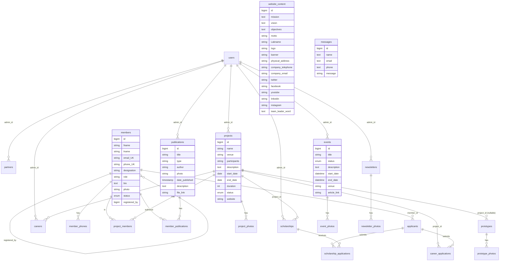
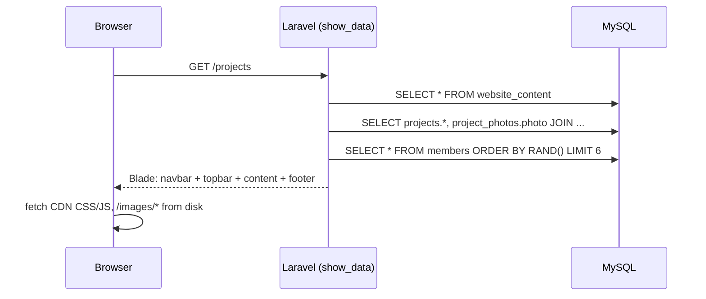
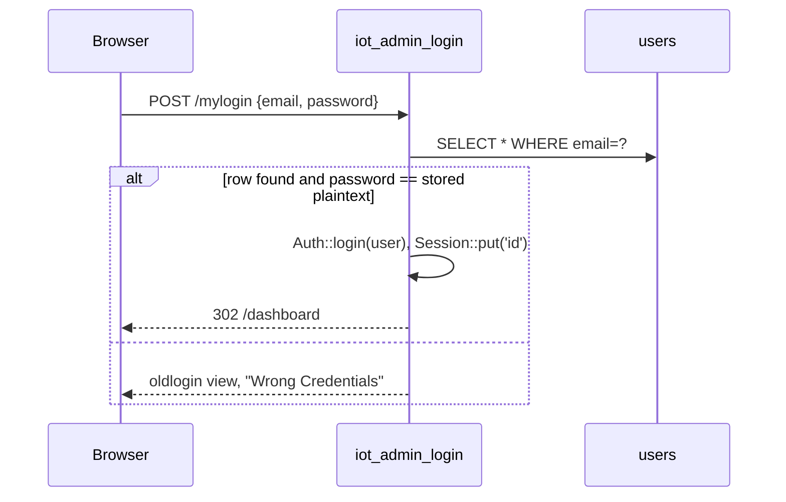
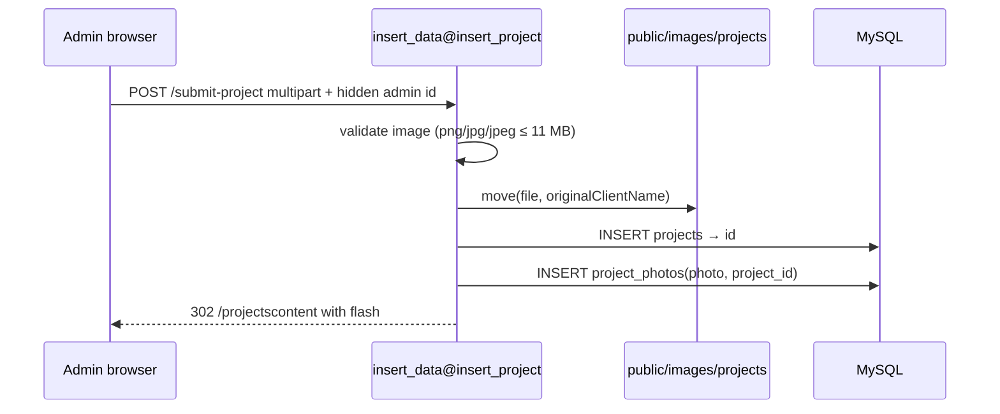

# System Design

**Baseline:** commit `af3c109`, 2026-10-20

This document covers the data model, request flows, file storage, routing and
the design constraints that follow from them. For module-level detail see
[SDD.md](SDD.md).

---

## 1. Data model

### 1.1 Entity-relationship diagram (as migrated)

`messages` and `sessions` are standalone tables. `users`, `password_reset_tokens`,
`personal_access_tokens` and `failed_jobs` are the Laravel/Jetstream defaults.

### 1.2 Table usage
| Table | Written by | Read by | Notes |
|---|---|---|---|
| `website_content` | `insert_home_form1`, `insert_contacts`, `edit_*` | Every page (`website_content::all()`) | Treated as a singleton |
| `members` | `insert_team`, `edit_team`, `edit_leader`, delete/restore | About, home, galleries, every page (random 6 photos) | `role` ∈ {leader, researcher, phd_stdt, masters_stdt, admin, intern}. This is free text, not an enum. |
| `partners` | `insert_partner`, `edit_partner` | Home, partners | |
| `projects` + `project_photos` | `insert_project`, `edit_project` | Projects, gallery, prototype form | One photo row per project at insert |
| `events` + `event_photos` | `insert_news`, `edit_event` | News, gallery | Many photos per event |
| `publications` | `insert_publication`, `edit_publication` | Publications | |
| `prototypes` + `prototype_photos` | `insert_prototype` | Publications, gallery | |
| `messages` | `insert_message` (public) | — | Never read |
| `users` | `insert_admin`, Fortify | Login | |
| scholarships, careers, applicants, *_applications, newsletters, newsletter_photos, member_phones, project_members, member_publications | — | — | Schema only |

### 1.3 Data-model observations
- `DB_mapping.txt` and the migrations disagree. For example, the mapping has
  an `admins` table, but the code uses `users`. Treat the migrations as the
  source of truth.
- `career_applications` references `project_id`, not `career_id`. This is
  almost certainly a design slip.
- `projects.status` and `events.status` default to `Ongoing`, and nothing in
  the UI changes them.
- `members.role = 'leader'` is assumed to be unique, but nothing enforces it.

---

## 2. Routing map

| Area | Method + path | Handler | Auth |
|---|---|---|---|
| Public | `GET /` `/about` `/projects` `/publications` `/news` `/partners` `/gallery` `/*_gallery` | `show_data@fetch_*` | none |
| Public | `POST /insert_message` | `insert_data@insert_message` | none |
| Login | `GET /oldlogin` (name `login`) | `iot_admin_login@logmein` | none |
| Login | `POST /mylogin`, **`GET /logmein`** | `iot_admin_login@login` | none |
| Register | **`GET /register`, `GET /registeradminform`, `POST /registeradmin`** | `iot_admin_login@registerme`, `insert_data@insert_admin` | **none** |
| Admin read | `GET /homecontent` `/aboutuscontent` `/projectscontent` `/publicationscontent` `/newscontent` `/registerprototype` `/oldteam` | `retrieve_data@fetch_*` | `auth` |
| Admin forms | `GET /dashboard`, `/register_*`, `/edit*` | `Route::view` | `auth` |
| Admin create | `POST /insertmission` `/insertpartner` `/insert_news` `/submit-project` `/insert_publication` `/insert_team` `/insertcontacts` `/insertprototype` | `insert_data@*` | `auth` |
| Admin update | `POST /edit*_route` | `edit_data@*` | `auth` |
| Admin member status | `POST /deleteuser?user_id=` `/restoreuser?user_id=` | `delete_stuff`, `restore_stuff` | `auth` |
| Fortify | `POST /logout`, `/user/profile`, 2FA, password reset, `POST /login`, `POST /register` | Fortify | mixed |
| API | `GET /api/user` | closure | `auth:sanctum` |

`Route::view('/homecontent')` and its siblings are registered first and then
overridden by the `Route::get(...)` lines for the same path. The view
registrations are dead code.

---

## 3. Key request flows

### 3.1 Public page render

Every public page reloads `website_content` for the navbar and footer and picks
6 random member photos for the footer gallery.

### 3.2 Admin login (current)

Fortify's login throttling is bypassed because this route doesn't go through
Fortify.

### 3.3 Create with upload (for example, a project)

There is no transaction, so a failure between the two inserts leaves a project
with no photo. Inner joins then hide that project from the public site.

### 3.4 Member deactivate / restore
`POST /deleteuser?user_id=N` sets `members.status = 'Inactive'`, and
`/restoreuser` sets it back to `Active`. Public queries filter on
`status = 'Active'`.

---

## 4. File storage design

| Upload | Directory under `public/` | Name used | DB column |
|---|---|---|---|
| Logo | `images/logo` | client original | `website_content.logo` |
| Banner | `images/banner` | client original | `website_content.banner` |
| Team / leader photo | `images/team` | client original | `members.photo` |
| Partner logo | `images/partners` (insert), `images/events` (edit ⚠) | client original | `partners.logo` |
| Event photos | `images/events` | client original | `event_photos.photo` |
| Project photo | `images/projects` | client original | `project_photos.photo` |
| Publication cover | `images/publications` | client original | `publications.photo` |
| Publication document | `documents/publications` | client original | `publications.file_link` |
| Prototype photo | `images/prototypes` | client original | `prototype_photos.photo` |

Consequences:
- Two uploads with the same name (for example `image.jpg`) overwrite each
  other, which changes earlier records without warning.
- Old files are never deleted.
- Files are not on Laravel's `Storage` abstraction, so they can't move to S3 or
  similar without code changes.

ADR-0007 proposes the replacement.

---

## 5. Scalability and performance
The expected load is low: one lab site with tens to hundreds of records. The
current design is adequate for that. If load grows, the levers are:
1. Cache `website_content` (it is read on every request) with `Cache::rememberForever`, cleared on edit.
2. Replace `ORDER BY RAND()` with a cached random sample.
3. Serve uploads from object storage or a CDN once they move to the `Storage` disk.
4. Pass the shared navbar/footer data with a view composer instead of
   re-querying it in every controller.

---

## 6. Target design direction (for planning)
These are not implemented. The ADRs describe them:
- One authentication stack (Fortify) with hashed passwords and invite-only admin creation (ADR-0006).
- Resource controllers per entity (`ProjectController`, `EventController`, …) with FormRequests and Eloquent relationships (ADR-0002 → ADR-0005 proposed).
- Uploads through `Storage::disk('public')` with generated names (ADR-0007).
- Remove the malicious artifact and add supply-chain guards (ADR-0008).
