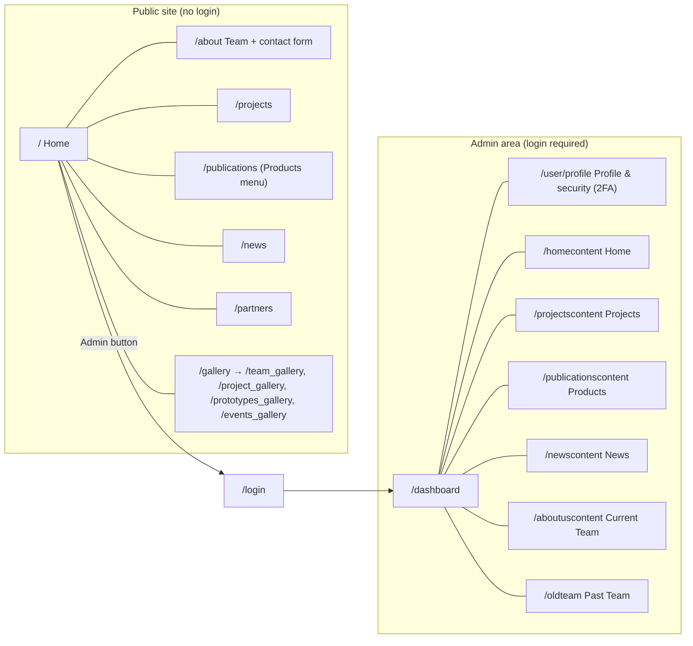
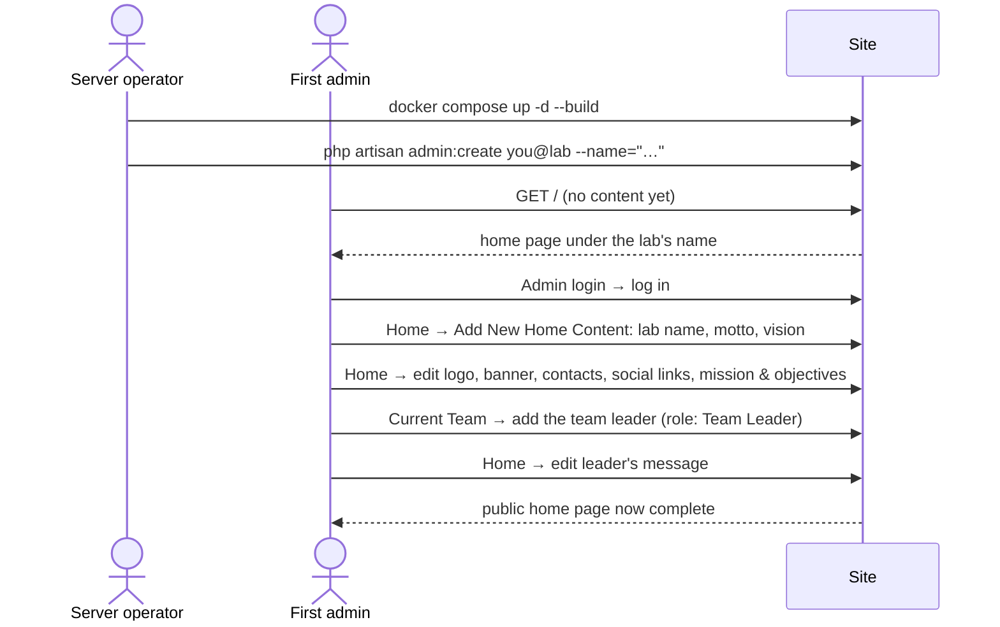

# Workflows

How people actually use the IoT-ra Lab website, step by step. Every workflow below was run end
to end in Chrome on **20 October 2026**, against the containerised site (Laravel 13, branch
`fix/security-and-stability`), starting from an empty database. Problems seen along the way
are referenced as **W1–W20**. They're listed in
[defects-and-malware-report.md §4b](defects-and-malware-report.md#4b-findings-from-the-browser-walkthrough-2026-10-20).

| Who | Can do |
|---|---|
| **Visitor** (anyone) | Browse the public pages and send a message through the contact form |
| **Admin** (a row in `users`) | Everything in the admin area. There are no roles: every admin can change everything. |

---

## 1. Site map

The admin sidebar labels don't always match the page names: **"Products"** is
publications and prototypes, and **"Current Team"** is the team list. Inside the admin area
the sidebar is the only navigation.

---

## 2. First-run setup (new install)

A fresh install has no site content yet. The public home page still shows, under the lab's
name from `APP_NAME`. The first admin logs in with the **Admin login** button and adds the
content. Until then, signed-in admins see "hasn't been added yet" hints on the home page,
linking to the right form (fix 016).

**Recommended order:**
1. lab identity
2. logo and banner
3. contacts and social links
4. mission and objectives
5. the team leader
6. the leader's message

The leader's message needs a leader on the team first. The leader's photo comes from their
team entry.

---

## 3. Admin: signing in and security

### 3.1 Log in
- **Where:** `/login`, via the "Admin" button on the public navbar. `/oldlogin` redirects
  here.
- **Steps:** enter your email and password, then **Login**.
- **Rules:**
  - The email is case-insensitive.
  - 5 attempts per minute per email + IP; after that, HTTP 429.
  - If 2FA is on, you're sent to `/two-factor-challenge` for the code.
- **Result:** you land on `/dashboard`, which greets you by name ("Hello Lab Admin").
- **On failure:** "These credentials do not match our records." The typed email isn't kept
  (W9).

### 3.2 Forgot password
- **Where:** the "Forgot password?" link on the login page, which opens `/forgot-password`.
- **Steps:** enter your email. A reset link is emailed. The link opens
  `/reset-password/{token}`, where you set a new password.
- **Needs:** working mail settings (`MAIL_*` in `.env`). Without them no email is sent.

### 3.3 Profile & security (password, 2FA, sessions)
- **Where:** sidebar → **Profile & security**, which opens `/user/profile`. The link was
  restored in [fix 012](fixes/012-profile-link.md).
- **Sections:**

| Section | What you can do |
|---|---|
| Profile information | Change your name and email |
| Update password | Current password plus a new one, typed twice |
| Two factor authentication | **Enable** → confirm your password → scan the QR code with an authenticator app → enter a code to confirm. Save the recovery codes. |
| Browser sessions | See where you're logged in; log out other sessions |
| Delete account | Removes your admin account. If you delete the last admin, the server operator has to run `admin:create` again. |

### 3.3a Locked out?
- **Forgot your password:** use "Forgot password?" on the login page. This only works when the
  server's email settings are filled in. Otherwise the page says so and asks you to contact
  the site administrator.
- **The server operator can help** without email:
  - `php artisan admin:password you@lab` sets a new password.
  - `php artisan admin:reset-2fa you@lab` turns off two-factor login if you lost your
    authenticator app and your recovery codes.

### 3.4 Register another admin
- **Where:** Current Team → **New System Admin**, which opens `/register`. Admins only; a
  guest is sent to `/login`.
- **Fields:** name, email (must be unique), password (at least 8 characters), and the
  password again.
- **Result:** "admin registered successfully". The password is stored hashed (bcrypt). You're
  taken back to the team list. There's no page listing admin accounts (W7).
- **On failure:** the first problem is shown at the top of the card, and the name and email
  are kept. For example: "The password field must be at least 8 characters."

### 3.5 Sign out
Sidebar → **Sign Out**. Admin pages then redirect to `/login`.

---

## 4. Admin: site content (sidebar → Home)

Everything on the public home page header, the contact bar and the footer comes from one
`website_content` record. The **Home** page lists each part with an edit (pencil) icon.

The red trash icons next to them do nothing (W2).

| Part | How to change it | Fields | Shown publicly |
|---|---|---|---|
| Lab identity | **Add New Home Content** → first form | Lab name, motto, vision | Home banner title and motto, Vision |
| Logo | Pencil next to **Logo** (`/editlogo?id=1`) | PNG/JPG, max 11 MB | Navbar, login card |
| Banner | Pencil next to **Banner** (`/editbanner?id=1`) | PNG/JPG | Home banner background |
| Contacts | Pencil under **Lab contacts** (`/editcontacts`) | Address, email, phone, each with a **Show on the website** switch | Top strip, footer, Team & contact page |
| Social links | Pencil under **Topbar information** (`/edittopbar`) | X (Twitter), Facebook, Instagram, YouTube, LinkedIn, each with a **Show on the website** switch | Icons in the top strip and footer |
| Mission & objectives | Pencil under **Home content** (`/edithome`) | Lab name, motto, vision, mission, objectives | Home page sections; one objective per line |
| Leader's message | Pencil under **Word from the team leader** (`/editleader`) | Message, optional new leader photo | Home page "Word from the team leader" |
| Partners | **Add New Home Content** → partner form | Name, description, logo (required), website | Home partners strip, `/partners` |

**Notes:**
- A contact detail or social link appears on the site only when it has a value **and** its switch is on. Switching it off keeps the value, and Admin Home marks it "Hidden on the website". Switching it back on restores it.
- `/register_home` holds **four separate forms**, each with its own Submit. Only the form
  whose button you press is saved (W13).
- Line breaks in vision, mission, objectives and bios are kept. HTML typed into them is
  shown as plain text: the test entry `<b>not bold</b>` appeared literally, not in bold.
- An `&` or `#` in any text is fine. Edit pages load the record by id (fix 006).
- Until a logo and banner are uploaded, the admin Home page and the public header show
  broken-image icons (W14).

---

## 5. Admin: team (sidebar → Current Team / Past Team)

### 5.1 Add a member
- **Where:** Current Team → **New Team Member**, which opens `/register_team`.
- **Fields:** first name, last name, email (unique), phone (unique), designation, role, photo
  (required) and bio.
- **Roles:**

| Option | Shown on About as |
|---|---|
| Team Leader | Senior Researchers; also on the home page with the leader's message |
| Researcher | Senior Researchers |
| PhD Student | PhD Students |
| Masters Student | Masters Students |
| Admin or Employee | Administrators |
| Intern | Interns |

- **Result:** "*Name* has been registered successfully!" The photo is saved under a random
  file name.
- **On failure:** the browser flags empty required fields first. The server also checks, and
  shows a red error box (for example, a duplicate email).

### 5.2 Edit a member
Current Team → **Edit**. All details can be changed except the phone number. A new photo is
optional.

### 5.3 Move a member to Past Team, and restore them
- Current Team → red trash icon → "Are you sure you want to delete this team member?" →
  **Yes, I'm sure**.
- Despite the wording, **nothing is deleted** (W8). The member's status becomes Inactive.
  They disappear from the public site and appear under **Past Team**.
- Past Team → orange restore icon → **Yes, I'm sure** → "the member was restored
  successfully". They're back on the public site.

---

## 6. Admin: projects (sidebar → Projects)

### Add
- **Where:** **Add New Project**, which opens `/register_projects`.
- **Fields:** name, venue, start and end date, number of participants, description,
  website, image.
- **Result:** "project added successfully!" The project appears under **Ongoing projects**
  and on `/projects`.

### Edit
- Pencil on the project card opens `/editproject?id=…`.
- You can change the name, venue, participants, website and description, and upload a new
  image.
- You can't change the dates or the status (W3).

### Known gaps
- **Projects can't be marked Past**, so they stay "Ongoing" for ever (W3).
- **Cards show "weeks" with no number** (W4).
- **Projects can't be deleted.**

---

## 7. Admin: news and events (sidebar → News)

### Add
- **Where:** **New News Event**, which opens `/register_news`.
- **Fields:** title, description, venue, article link, start and end date, and **several
  photos at once**.
- **Rules:** photos must be PNG or JPG. Any other file type is rejected (fix 003).
- **Result:** "event added successfully!" The event appears under **Upcoming Events** with
  all of its photos.

### Edit
- Pencil on the event card opens `/editnews?id=…`.
- The text and dates can be changed.
- A new photo is optional, and if you add one it **joins** the event's gallery rather than
  replacing it.

### Known gaps
- **Events never move to Past**, so a September event still shows as "Upcoming" in October
  (W3).
- **Cards show hard-coded "3 weeks" and "6 people"** (W1).
- **Events can't be deleted.**

---

## 8. Admin: publications and prototypes (sidebar → Products)

### Add a publication
- **Where:** **Add New Publication**, which opens `/register_publications`.
- **Fields:**
  - type (Report or Dataset)
  - title, author, publication date, description
  - **cover image** (PNG/JPG)
  - **document** (PDF, DOC/DOCX, XLS/XLSX or CSV, max 11 MB)
- **Result:** "publication added successfully!" It's listed under **Data sets and Technical
  Reports**, and the file can be downloaded from `/publications`. The admin list shows the
  stored file name, not a meaningful one (W19).

### Edit a publication
- Each row has an **Edit** link. Text can be changed.
- A new cover or document is optional.

### Add a prototype
- **Where:** the small "go" link on the publication form opens `/registerprototype` (W16).
- **Fields:** title, project (pick from a list), description, image (required).
- **Result:** "prototype added successfully!" It's shown under **Prototypes**.

### Known gaps
- **Prototypes can't be edited.**
- **The project list has no "No project" option** (W16).

---

## 9. Visitor workflows

| Page | What visitors see |
|---|---|
| `/` Home | Lab name and motto over the banner; vision, mission, objectives; word from the team leader; partners |
| `/about` | Team grouped by role, with a short bio and "Read more"; contact details; the **Get in touch** form; partners |
| `/projects` | Project cards with photo, venue and description |
| `/publications` (menu "Research") | Prototypes, then publications with downloadable files |
| `/news` | Events with their photos |
| `/partners` | Partner logos and descriptions |
| `/gallery` and the four sub-galleries | Photos of the team, projects, prototypes and events |

### Send a message (About → Get in touch)
- **Fields:** name, email and message are required; phone is optional.
- **Rules:** limited to 5 messages per minute per IP.
- **On failure:** for example "The email field must be a valid email address" or "The
  message field is required". The page goes back to the top and the typed text is lost
  (W10).
- **Result:** the message is saved in the `messages` table, and a thank-you note appears
  above the form.
- **Gap:** **no admin page shows these messages yet**, so nobody reads them (W6).

### Menu and footer
- **Menu:** Home · Projects · Research · News · Team & contact · Admin login.
- **Footer:** Projects, Research, News, Partners, Gallery, Contact us; the lab's contacts; and
  the social links the admin entered.
- **Before 2026-10-21 (W11):** some footer items weren't links, and a newsletter box was
  connected to nothing. Both were removed in [fix 013](fixes/013-public-redesign.md).

**Signed-in admins** browsing the public site see dashed hints wherever content hasn't been
added yet, each linking to the admin page where it's added. Visitors never see these hints.

---

## 10. Where everything is stored

| Workflow | Database table(s) | Uploaded files (on the host: `data/…`) |
|---|---|---|
| Site content | `website_content` (one row) | `images/logo`, `images/banner` |
| Partners | `partners` | `images/partners` |
| Team | `members` (status Active/Inactive) | `images/team` |
| Projects | `projects`, `project_photos` | `images/projects` |
| News/events | `events`, `event_photos` | `images/events` |
| Publications | `publications` | `images/publications`, `documents/publications` |
| Prototypes | `prototypes`, `prototype_photos` | `images/prototypes` |
| Contact messages | `messages` | — |
| Admins | `users` (bcrypt passwords, 2FA secrets encrypted) | — |

Uploaded files always get a random name (for example `TtWqsf….png`), so two uploads called
`photo.jpg` can't overwrite each other. Files in the upload folders can't run as scripts.
